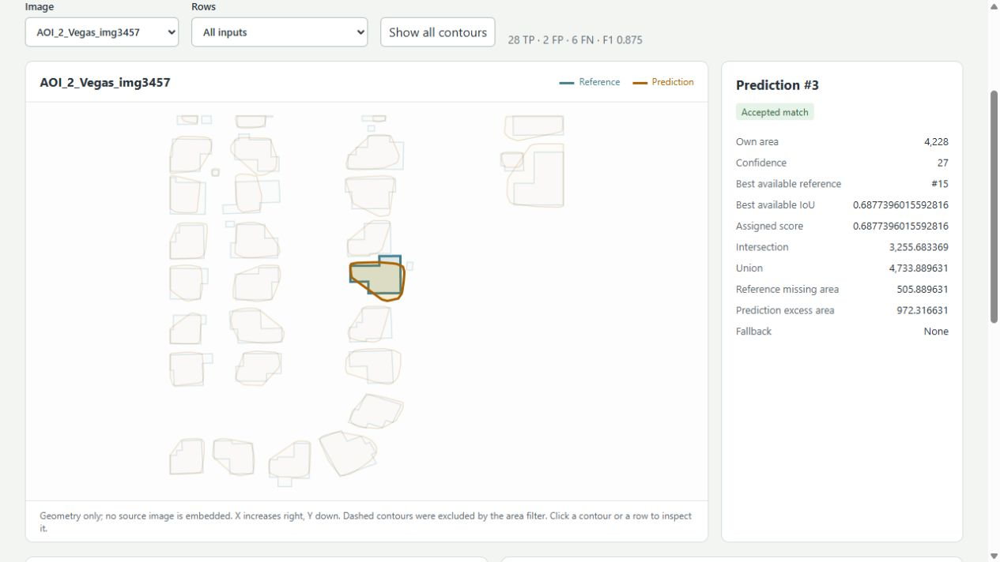

# Polygon intersection area and IoU in .NET from double coordinates

How much area do two polygons share? How closely does a predicted building outline
match its reference annotation? [PolylineKit](https://github.com/bgtnt/polylinekit)
provides numeric area and overlap measurements directly from `double` XY
coordinates, with an explicit fill rule for self-intersecting paths.

The MIT-licensed `PolylineKit.Core` package has no external runtime dependencies
and targets .NET Standard 2.0 and .NET 10. This example uses
[0.1.0-alpha.3 on NuGet](https://www.nuget.org/packages/PolylineKit.Core/0.1.0-alpha.3).

Create a console app and install that version:

```sh
dotnet new console -n PolygonOverlap
cd PolygonOverlap
dotnet add package PolylineKit.Core --version 0.1.0-alpha.3
```

Replace `Program.cs` with these five lines, using C# 12 or later:

```csharp
using PolylineKit;
Point2[] first = [new(0, 0), new(2, 0), new(2, 2), new(0, 2)];
Point2[] second = [new(1, 0), new(3, 0), new(3, 2), new(1, 2)];
var overlap = PolylineArea.CompareRegions(first, second, PathFillRule.NonZero);
Console.WriteLine($"Intersection = {overlap.IntersectionArea}; IoU = {overlap.IntersectionOverUnion}");
```

Run `dotnet run`. The intersection is **2 square coordinate units**, the union is
**6**, and intersection over union (IoU) is **1/3**. `CompareRegions` also returns
each region's area and their symmetric difference. If you only need shared area,
use `PolylineArea.IntersectionArea`.

Paths close implicitly. `NonZero` is the default fill rule; choose
`PathFillRule.EvenOdd` when parity filling matches your data. IoU is `null` when
the union has no positive area. Coordinates retain their supplied position and
scale, so annotation comparisons use the original image coordinates and GIS
areas require a suitable planar coordinate system.

For holes, pass the exterior and hole rings to
`PreparedRegion.FromPolygon(exterior, holes)`. For a multipolygon or disconnected
components, use `PreparedRegion.FromPolygons(polygons)`, supplying each exterior
with its holes. These factories orient copied rings by their supplied roles;
`RegionArea.FilledArea`, `IntersectionArea` and `Compare` then measure the prepared
regions. Raw `FromRings` preserves ring directions for deliberate winding input.
The [region guide](regions.md) includes runnable hole and multipolygon examples,
and the repository includes a
[NetTopologySuite conversion example](../examples/NetTopologySuiteInterop/README.md).

The [building annotation evaluator](../examples/PolygonOverlapEvaluation/README.md)
shows how intersection and IoU become a review workflow: matched and missed
buildings, false detections, and missing/excess area for a selected prediction.



Actual HTML review of `AOI_2_Vegas_img3457`: prediction **#3**, accepted reference
**#15**, IoU **0.6877396015592816**, missing area **505.889631 pixel²**, and excess
area **972.316631 pixel²**. The screenshot shows original contours and measured
values, with no image raster.

Core returns numeric measurements; use Clipper2 when you need output polygons or
offsets, and NetTopologySuite when you need its geometry model and topology
operations. Performance depends on the geometry and how inputs are reused; the
[recorded workloads and reproduction commands](performance.md#recorded-results-by-scenario)
help you assess that tradeoff.

This is an alpha: APIs may evolve, areas carry floating-point rounding, and Core
does not validate or repair polygon topology or compute geodesic areas.

Try it with your own pair of polygons. If the result surprises you, open a
[polygon trial](https://github.com/bgtnt/polylinekit/issues/new?template=polygon-trial.yml) with a minimal
reproduction, package version, input coordinates, expected and actual results,
and the fill rule you used.
