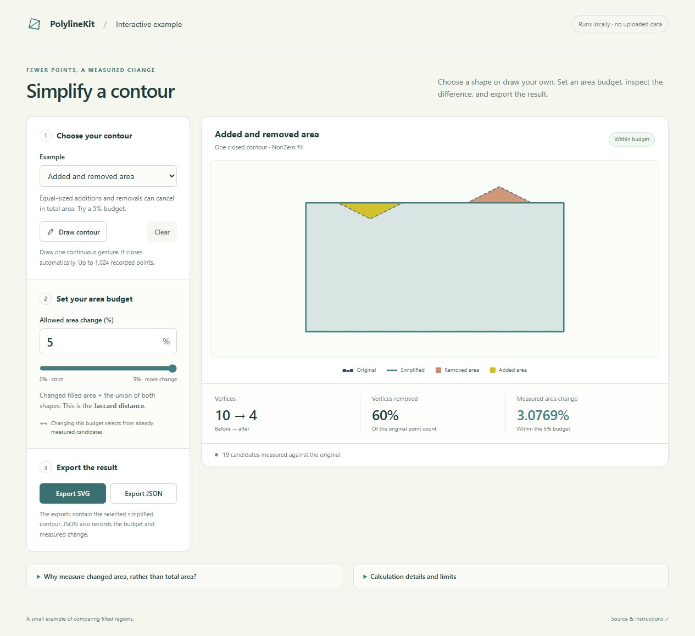

# Simplify a contour within an area-change budget

Draw a closed selection, load a JSON contour or choose an existing contour, set
how much filled area may change, and export the measured simplified result. The demo compares a finite
set of candidates with the **original** shape and chooses the one with the fewest
vertices that satisfies your budget.



This screen shows the generated four-vertex candidate for the small analytic
input at a 5% budget. Both coloured differences contribute to the measured change.

## Run locally

Install the .NET 10 SDK, then run from the repository root:

```sh
dotnet run --project examples/ContourSimplificationDemo -c Release
```

Open **http://127.0.0.1:5090/**. Restore needs the example's locked Clipper2
package; subsequent runs use the bundled frozen inputs without external services,
a JavaScript build step, a CDN or a database. The server listens on loopback by
default. `--urls` can select another local port.

The default preset is Bulgaria. You can also choose Switzerland, Lesotho, Nepal
or the small added/removed-area example. In drawing mode, one completed pointer
gesture becomes an implicitly closed contour. The demo accepts at most 1024
supplied points, removes consecutive and closing duplicates and requires at least
three remaining vertices with positive finite `NonZero` filled area.
Self-intersecting contours are allowed; a zero algebraic area alone is not a
rejection criterion.

## What the budget measures

```text
changed area = area(original symmetric-difference simplified)
error        = changed area / area(original union simplified)
```

This is **Jaccard distance**. `0.7%` means the fraction `0.007`; it is not changed
area divided by the original area. The budget initially allows 0.7% and the
control spans 0–5%. Original and simplified contours are independently filled
using `NonZero` in the same coordinates. Changing the budget reuses the already
measured candidates in your browser until you change the input.

The fixed explanatory input contains opposing triangles, each with base 2 and
height 0.5. Its area and the enclosing rectangle's area are both 32. The analytic
rectangle comparison removes 0.5 and adds 0.5: changed area is 1, union is 32.5,
Jaccard distance is `1 / 32.5`, or approximately 3.0769%. This fixed pair explains
why net area change can be zero while the filled shape changes; it is labelled an
analytic control. The interactive preset still generates its candidates through
the real simplifier and shows their measured numbers.

Small changed area does not bound maximum boundary displacement or guarantee
topology preservation. A thin feature can disappear while contributing little
area. No alignment, normalization or geometry repair occurs on your drawing.

## Candidate policy and library roles

Clipper2 2.0.0 generates closed-path simplifications directly from the original.
With `L` the longer side of the input bounds, epsilon is `L` times each value:

```text
0.0001, 0.0002, 0.0004, 0.0007,
0.001,  0.0015, 0.002,  0.003,
0.004,  0.006,  0.008,  0.012,
0.016,  0.024,  0.032,  0.05,
0.075,  0.1
```

PolylineKit measures each usable candidate's filled-area change. The original
is an additional fallback with zero error. Degenerate or numerically unsuitable
candidates are omitted with a diagnostic reason. Results are never clamped to
the budget interval.

The browser selects among **all** measured candidates with error at most the
budget, ordering by vertex count, then error, epsilon and stable index. It does
not assume error increases monotonically with epsilon. This is the best result
among this finite series, not a globally minimal polygon or a new simplification
algorithm.

Clipper2 is a dependency of this example only. Core has no Clipper dependency.
Clipper2 can also measure the same criterion through its Boolean operations and
area function: the example demonstrates a useful consumer flow, without proving
that the task is unique to PolylineKit or that this consumer is faster.

## Inputs, coordinates and exports

Use **Load JSON** to import one contour from a local file. The file can contain
a bare `[[x,y],...]` array or an object with a `points` array, including a JSON
export from this demo:

```json
{"name":"My contour","fillRule":"NonZero","points":[[0,0],[8,0],[8,4],[0,4]]}
```

`name` is optional and displayed as text; it must be valid XML text for SVG export.
An omitted fill rule uses `NonZero`; any explicit different `fillRule` is rejected.
Other exported metadata is ignored:
the imported points become the new original, candidates are measured afresh, and
your current budget stays in effect. Coordinates retain their supplied units and
values, with no scaling, resampling or topology repair.

JSON files are limited to **128 KiB (131,072 bytes)** and **1,024 supplied points**,
counting duplicates before cleanup. Each point must contain exactly two finite
JSON numbers with magnitude at most `1e100`; numeric strings are not accepted.
Consecutive and closing duplicates are removed, and at least three vertices must
remain. Malformed or unsupported files are rejected before an API request and
keep the current contour and exports. Positive finite `NonZero` filled area is
checked by the server; if measurement rejects an imported contour, a previous
usable result is restored when available. A newer contour or file selection
supersedes a file that is still being read.

The four Natural Earth v5.1.2, 1:50m country contours are linked directly from
[AreaChange/data](../AreaChange/data/manifest.json). Startup verifies the pinned
manifest, file hashes and vertex counts. No holes or islands were discarded
from these four complete single-ring source features.

Made with Natural Earth; its data are
[public domain](https://www.naturalearthdata.com/about/terms-of-use/). Source
longitude/latitude was converted by the existing freeze to a local
equirectangular plane and scaled uniformly to a longest bound of 1000. Displayed
areas are **squared local coordinate units**, not square kilometres. Drawings use
the canvas coordinate system; zoom and display size do not change stored geometry.

The SVG export contains the current simplified contour with an explicit
`nonzero` fill rule and its actual coordinates. JSON contains the same points,
fill rule, budget fraction, measured Jaccard distance and vertex counts. Exports
are disabled while a changed input has no current scored result.

Superseded measurement requests are canceled cooperatively between geometry
calls and candidates. A geometry operation already executing runs to completion
before cancellation is observed.

The API uses coordinate arrays rather than serializing `Point2` implicitly:

- `GET /api/presets` returns `{id,name,description,points}` objects.
- `POST /api/candidates` accepts `{points:[[x,y],...]}` and returns the cleaned
  original, its area, the measured finite candidate set and skipped diagnostics.
- Invalid input returns HTTP 400 JSON `{error: ...}`. Unexpected calculation
  failures fail the request; they are not disguised as a valid original result.

## Checks

```sh
dotnet run --project examples/ContourSimplificationDemo -c Release -- --check
```

Console checks cover input limits and degenerate inputs, a filled bow-tie with
zero algebraic area, exact square/collinear and added/removed controls, inclusive
budget thresholds, percent units, deliberately nonmonotone candidate errors,
stable ties, strict-budget fallback, skipped candidates and all frozen presets.
They also check cancellation before candidate generation.

The reproducible browser suite uses the pinned, **test-only** Playwright package
in [tests/ContourSimplificationDemo.Browser](../../tests/ContourSimplificationDemo.Browser).
It adds no Core or demo runtime dependency. Install Node.js 20 or newer and build
the example, then run from the repository root with an existing Microsoft Edge:

```sh
dotnet restore examples/ContourSimplificationDemo --locked-mode
dotnet build examples/ContourSimplificationDemo -c Release --no-restore
npm ci --prefix tests/ContourSimplificationDemo.Browser
npm run test:edge --prefix tests/ContourSimplificationDemo.Browser
```

For Playwright's pinned Chromium, including the Linux CI run:

```sh
cd tests/ContourSimplificationDemo.Browser
npx playwright install --with-deps chromium
npm test
```

Playwright starts and stops the real Release server on `127.0.0.1:5091` and loads
its production HTML and `app.js`. Seven tests cover real API startup, selection
across a nonmonotone candidate series, inclusive 0.7% and 0.5% boundaries,
scientific percent input, cached budget edits, actual JSON/SVG downloads, and an
older HTTP response arriving after the newer one. Import checks exercise local
coordinates and export round trips through the real API, file/schema/size limits,
prior-result preservation, ending an active drawing gesture and delayed file
reads. Controlled API responses make the boundary and race cases deterministic;
the HTTP race deliberately lets a request
finish after abort to verify the input-version guard. Failures retain Playwright
traces under `artifacts/contour-demo-browser`.

The initial implementation also passed 354 console assertions and 36 local
checks in an isolated Microsoft Edge session. Those broader delivery checks
covered pointer gestures, the 1024-point cap, invalid inputs and narrow-screen
layout; added and removed fill was inspected in the running demo. They remain
local delivery evidence, distinct from the committed CI browser tests.

Separate `FirstOnlyArea`/`SecondOnlyArea` metrics may become useful later. They
are not needed for this version: PolylineKit supplies XOR and union numerically,
and SVG masks distinguish the added and removed fill visually.
